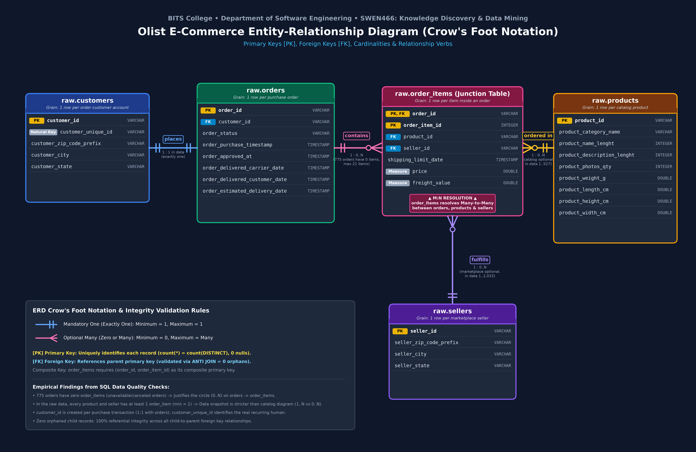

# SWEN466: Knowledge Discovery & Data Mining
## Assignment 1: Data Quality Analysis and ERD Design

**Student Name:** Yeabsira Kayel  
**Department:** Software Engineering, BITS College  
**Course:** SWEN466 - Knowledge Discovery and Data Mining  

---

## 📌 Deliverables Overview

This repository contains the required deliverables for Assignment 1:

1. **Entity-Relationship Diagram (ERD):**
   - [`erd_diagram.png`](./erd_diagram.png) & [`erd_diagram.pdf`](./erd_diagram.pdf) (Modern dark theme)
   - [`erd_diagram_light.png`](./erd_diagram_light.png) & [`erd_diagram_light.pdf`](./erd_diagram_light.pdf) (High-contrast light theme)
   - Features Crow's Foot notation, primary key `[PK]` and foreign key `[FK]` markers, composite keys, relationship cardinalities, and relationship verbs (`places`, `contains`, `ordered in`, `fulfills`).

2. **Jupyter Notebook with Data Quality Checks:**
   - [`DWH_OLAP_Assignment_1_Notebook.ipynb`](./DWH_OLAP_Assignment_1_Notebook.ipynb)
   - Complete DuckDB SQL queries for Exercises 1–5 in Section 5 (reading only from `raw.<table>`).
   - Pre-executed with all output tables and the monthly orders bar chart.

3. **Short Note:**
   - [`SHORT_NOTE.md`](./SHORT_NOTE.md)
   - Detailed answers to questions 4a, 4b, and 4c (customer identifiers, junction table, and empirical cardinality findings).
   - Table grains, referential integrity checks (0 orphans), and embedded Mermaid ERD.

---

## 📊 Entity-Relationship Diagram (ERD)



### Summary of Relationships

| Relationship | Parent Entity | Child Entity | Foreign Key | Cardinality in Data | Verb | Notes |
| :--- | :--- | :--- | :--- | :--- | :--- | :--- |
| **Customers & Orders** | `raw.customers` | `raw.orders` | `customer_id` | Exactly 1 (`\|\|`) | `places` | Each `customer_id` is created per purchase order (1:1). |
| **Orders & Items** | `raw.orders` | `raw.order_items` | `order_id` | Zero or Many (`o<`) | `contains` | **775 orders have 0 items** (justifies the circle `o`), up to 21 items max. |
| **Products & Items** | `raw.products` | `raw.order_items` | `product_id` | Zero or Many (`o<`) | `ordered in` | Catalog design allows `0..N`; snapshot data has 1..527 items. |
| **Sellers & Items** | `raw.sellers` | `raw.order_items` | `seller_id` | Zero or Many (`o<`) | `fulfills` | Marketplace design allows `0..N`; snapshot data has 1..2,033 items. |

---

## 🔍 Data Quality Exercises Summary

| Exercise | Section | Question Focus | Key Finding |
| :--- | :--- | :--- | :--- |
| **Exercise 1** | 5.1 Orders with no items | Orders without line items grouped by status | 775 orders total (603 `unavailable`, 164 `canceled`, 5 `created`, 2 `invoiced`, 1 `shipped`). |
| **Exercise 2** | 5.2 Order status & imbalance | Status frequency and class percentage | Severe class imbalance: `delivered` represents 97.02% (96,478), while `shipped` is 1.11% and `canceled` is 0.63%. |
| **Exercise 3** | 5.3 Timestamp anomalies | Missing timestamps and chronological inversions | 160 missing approvals, 1,783 missing carrier dates, 2,965 missing customer deliveries, 8 delivered orders with no delivery date, and 23 orders where carrier date occurred after customer delivery. |
| **Exercise 4** | 5.4 Time coverage | Monthly purchase counts across 2016–2018 | 25 months of coverage with partial startup months (Sep 2016: 4) and wind-down months (Oct 2018: 4); peak during Nov 2017 (7,544). |
| **Exercise 5** | 5.5 Product completeness | Null categories, weights, and zero weights | 32,951 products, 610 missing categories, 2 missing weights, 4 zero weights, across 73 distinct categories. |

---

## 🛠️ Setup & How to Run

1. Clone the repository:
   ```bash
   git clone https://github.com/yeabkal1001/kddm_lab.git
   cd kddm_lab
   ```

2. Install dependencies:
   ```bash
   pip install duckdb pandas matplotlib pyarrow
   ```

3. Download the Olist dataset CSV files into `data/raw/`:
   - `olist_customers_dataset.csv`
   - `olist_orders_dataset.csv`
   - `olist_order_items_dataset.csv`
   - `olist_products_dataset.csv`
   - `olist_sellers_dataset.csv`

4. Launch Jupyter Notebook / JupyterLab:
   ```bash
   jupyter lab
   ```
   Open `DWH_OLAP_Assignment_1_Notebook.ipynb` and run all cells.
