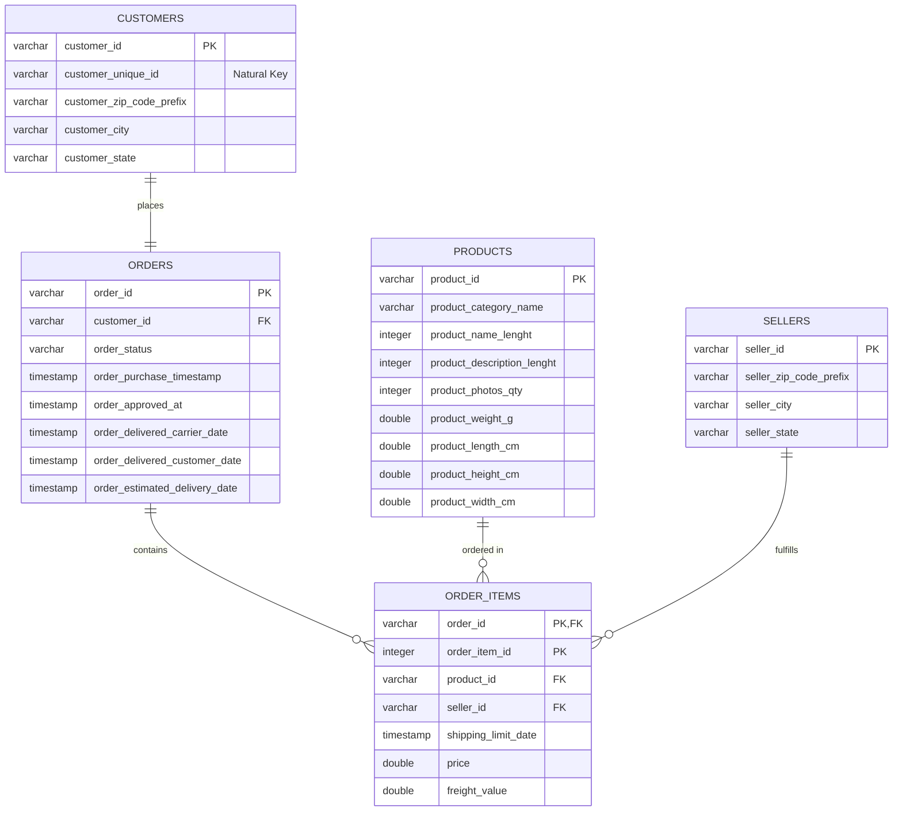

# SWEN466: Knowledge Discovery and Data Mining
## Assignment 1: Data Quality Analysis and ERD Design
**Institution:** BITS College • Department of Software Engineering  
**Deliverable:** Short Note (Data Quality Findings, Entity Cardinalities, and Conceptual Design)

---

### 1. Answers to Required Questions

#### **a. Two columns in the `customers` table look like customer identifiers. How do they differ, and which one would you use to count customers?**
In `raw.customers`, `customer_id` is an operational key generated per purchase transaction (effectively an order-specific token), whereas `customer_unique_id` represents the actual human individual across all their shopping history. When a customer returns to place another order, they are assigned a new `customer_id`, but retain the same `customer_unique_id`. In the dataset, counting `customer_id` yields 99,441 records (matching total orders 1:1), whereas counting distinct `customer_unique_id` yields 96,096 distinct people. Therefore, **`customer_unique_id`** must be used to accurately count customers, while `customer_id` merely counts order transactions.

---

#### **b. Which table is a junction table, and which relationships does it resolve?**
The **`order_items`** table serves as the junction (associative) table in this operational schema. It resolves the many-to-many ($M:N$) relationship between `orders` and `products` (as well as between `orders` and `sellers`), because a single customer order can contain multiple products, and a single product can be purchased across many different customer orders. By breaking this $M:N$ connection into binary one-to-many relationships (`orders` $1 \rightarrow N$ `order_items` $N \leftarrow 1$ `products`), `order_items` uniquely identifies each order line using the composite primary key `(order_id, order_item_id)` and records transaction-specific line measures such as `price` and `freight_value`.

---

#### **c. Name one relationship where the data is stricter than your diagram, and one where the circle on your diagram is justified by the data.**
1. **Where the circle is justified by data (`0..N`):**  
   The relationship between **`orders` and `order_items`** justifies the optional circle (`0..N`). SQL data quality checks using `ANTI JOIN` reveal **775 orders with zero items** in `raw.order_items` (orders with statuses such as `unavailable` [603] and `canceled` [164] that were created but never fulfilled).
2. **Where the data is stricter than the diagram (`1..N` vs `0..N`):**  
   The relationship between **`products` and `order_items`** (as well as `sellers` to `order_items`) is stricter in the data than in the conceptual business model. In a standard retail catalog model, products can exist in the database before receiving any purchase orders (`0..N`), yet in this dataset snapshot, every product in `raw.products` has at least one associated record in `raw.order_items` ($\min = 1$, $\max = 527$). Thus, the empirical data contains no unsold products, making the physical data strictly $1..N$.

---

### 2. Summary of Table Grains, Primary Keys, and Foreign Keys

| Table | One Row Represents (Grain) | Primary Key (PK) | Foreign Keys (FK) | Row Count |
| :--- | :--- | :--- | :--- | :--- |
| **`raw.customers`** | One order-level customer account | `customer_id` | None | 99,441 |
| **`raw.orders`** | One commercial purchase order | `order_id` | `customer_id` $\rightarrow$ `customers` | 99,441 |
| **`raw.order_items`** | One physical line item inside an order | Composite `(order_id, order_item_id)` | `order_id` $\rightarrow$ `orders`<br>`product_id` $\rightarrow$ `products`<br>`seller_id` $\rightarrow$ `sellers` | 112,650 |
| **`raw.products`** | One unique product in the catalog | `product_id` | None | 32,951 |
| **`raw.sellers`** | One registered marketplace merchant | `seller_id` | None | 3,095 |

---

### 3. Empirical Cardinality and Referential Integrity Measurements

All parent-child relationships were verified using SQL `ANTI JOIN` queries to detect orphaned records:

| Parent Table | Child Table | Linking Column | Cardinality in Data | Conceptual Notation | Orphan Count |
| :--- | :--- | :--- | :--- | :--- | :--- |
| `raw.customers` | `raw.orders` | `customer_id` | Exactly 1 ($\min=1, \max=1$) | Mandatory One (`\|\|`) | **0 orphans** |
| `raw.orders` | `raw.order_items` | `order_id` | 0 to 21 ($\min=0, \max=21$) | Zero or Many (`o<`) | **0 orphans** (775 orders have 0 items) |
| `raw.products` | `raw.order_items` | `product_id` | 1 to 527 ($\min=1, \max=527$) | Zero or Many (`o<`) | **0 orphans** |
| `raw.sellers` | `raw.order_items` | `seller_id` | 1 to 2,033 ($\min=1, \max=2033$) | Zero or Many (`o<`) | **0 orphans** |

---

### 4. Data Quality Check Queries (Notebook Exercises 1–5)

#### **Exercise 1 (Section 5.1): Orders with No Items**
```sql
SELECT 
    o.order_status, 
    count(*) AS orders_without_items
FROM raw.orders o
ANTI JOIN raw.order_items i USING (order_id)
GROUP BY o.order_status
ORDER BY orders_without_items DESC;
```
*Result:* 603 `unavailable`, 164 `canceled`, 5 `created`, 2 `invoiced`, 1 `shipped` (Total: 775 orders).

#### **Exercise 2 (Section 5.2): Order Status Class Imbalance**
```sql
SELECT 
    order_status,
    count(*) AS n,
    round(100.0 * count(*) / sum(count(*)) OVER (), 2) AS pct
FROM raw.orders
GROUP BY order_status
ORDER BY n DESC;
```
*Result:* `delivered` accounts for 96,478 orders (97.02%), followed by `shipped` (1,107, 1.11%), `canceled` (625, 0.63%), and `unavailable` (609, 0.61%).

#### **Exercise 3 (Section 5.3): Missing and Inconsistent Timestamps**
```sql
SELECT
    count(*) FILTER (WHERE order_approved_at IS NULL) AS approved_null,
    count(*) FILTER (WHERE order_delivered_carrier_date IS NULL) AS carrier_null,
    count(*) FILTER (WHERE order_delivered_customer_date IS NULL) AS delivered_null,
    count(*) FILTER (WHERE order_status = 'delivered' AND order_delivered_customer_date IS NULL) AS delivered_but_no_date,
    count(*) FILTER (WHERE order_delivered_carrier_date > order_delivered_customer_date) AS carrier_after_customer
FROM raw.orders;
```
*Result:* 160 missing approvals, 1,783 missing carrier dates, 2,965 missing delivery dates, 8 delivered orders missing delivery timestamps, and 23 chronological anomalies where carrier delivery occurred after customer delivery.

#### **Exercise 4 (Section 5.4): Time Coverage**
```sql
monthly = q("""
SELECT
    strftime(order_purchase_timestamp::TIMESTAMP, '%Y-%m') AS month,
    count(*) AS orders
FROM raw.orders
GROUP BY month
ORDER BY month;
""")
```
*Result:* Spans 25 months from September 2016 through October 2018, with partial months at both extremities (Sep 2016: 4 orders, Oct 2018: 4 orders) and full volume across 2017–2018 (peaking at 7,544 in Nov 2017 during Black Friday).

#### **Exercise 5 (Section 5.5): Product Completeness Check**
```sql
SELECT
    count(*) AS products,
    count(*) FILTER (WHERE product_category_name IS NULL) AS category_null,
    count(*) FILTER (WHERE product_weight_g IS NULL) AS weight_null,
    count(*) FILTER (WHERE product_weight_g = 0) AS weight_zero,
    count(DISTINCT product_category_name) AS n_categories
FROM raw.products;
```
*Result:* 32,951 total products, 610 missing categories, 2 missing weights, 4 zero weights, and 73 distinct non-null product categories.

---

### 5. Mermaid Entity-Relationship Diagram


